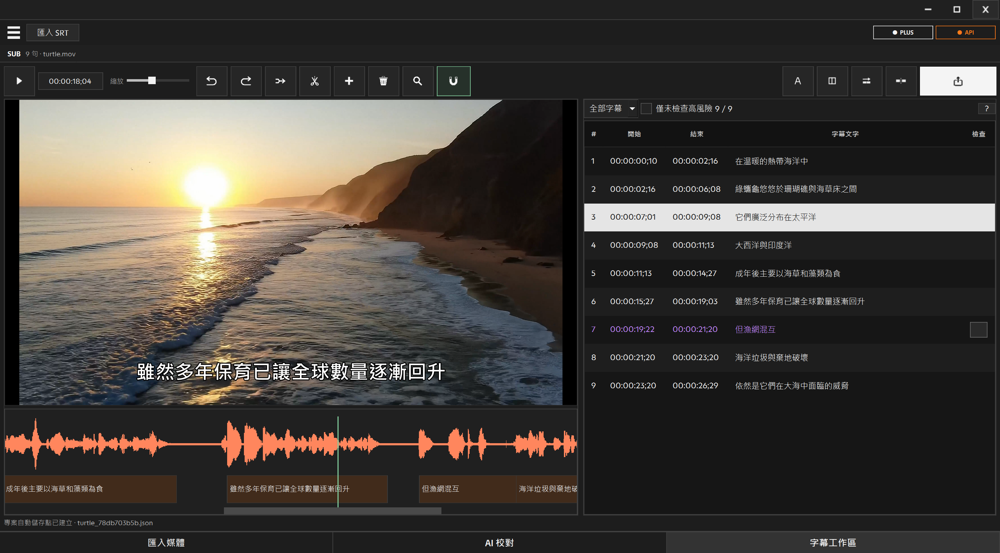
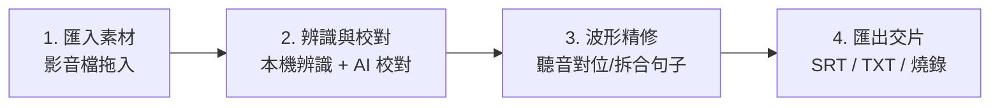

# SanWich 聲文去 (V3)

  
  
  
  

> **專為影片剪輯師與創作者打造的 Windows 語音轉文字、節奏斷句與字幕精修工作台**  
> 專注解決訪談整理、專有名詞校正、長短影音閱讀節奏與剪輯軟體對接痛點。

---

---

## 為什麼選擇 SanWich？

市面上語音轉文字工具很多，但把逐字稿放進剪輯軟體（如 DaVinci Resolve、EDIUS）時，剪輯師往往要花更多時間收拾殘局：人名被打錯、一句話被切成三截、斷句不合閱讀節奏，或時間碼總是差了幾格。

SanWich 是由一線剪輯師開發，專門處理進剪輯軌前的「後製第一道關卡」：

> 部分功能（如詞庫與自訂校對規則）依方案而定，詳見下方〈方案說明〉。

| 剪輯痛點 | SanWich 解決方案 |
|---|---|
| **字幕長度不合節奏** （字數忽長忽短、閱讀吃力） | **節目級斷句節奏**：提供「訪談/長片（每句約 14 字）」、「綜藝/短影音（每句約 8 字）」與「自訂（指定目標字數）」三種斷句風格，切出好讀的句子。 |
| **受訪者專名、術語常打錯** （手動逐字改到懷疑人生） | **補充資料與個人詞庫**：事前填入人名、品牌、背景與正確用字，作為 AI 校對的參考；PLUS／PRO 可另外保存個人詞庫與校對偏好。校對以保留原話為原則，結果仍請對照原音確認。 |
| **不確定 AI 到底改了什麼** （害怕漏看關鍵字被改掉） | **AI 修改標示與完成詳情**：經 AI 修改的字幕在時間軸上另以顏色標示；完成詳情分別列出已套用的修改、保留原稿與未完成的部分；高風險句可篩選並逐句標記已檢查。 |
| **字幕進出點不準、破音卡字** （反覆切換視窗重聽） | **內建視覺化波形編輯器**：直接在軟體內聽音對位、微調時間碼、快速拆句與合併，標記待確認句子。 |
| **與剪輯軟體對接** （編碼錯誤、格式不相容） | **標準格式匯出**：輸出 UTF-8 編碼的 SRT 字幕檔與 TXT 逐字稿，亦可預覽字幕外觀並輸出燒錄字幕的影片。 |

---

## 4 步剪輯字幕工作流

1. **匯入素材**：拖放影音或錄音檔，選擇產生字幕（SRT）、逐字稿（TXT）或兩者兼具。
2. **語音轉文字與 AI 校對**：
   - 透過本機模型進行語音辨識，音訊不需上傳（首次使用需下載運算環境與模型）。
   - 填入本次訪談背景、受訪者人名或專有名詞，交由 AI 依據背景進行差異校對。
3. **原音波形對照與精修**：
   - 進入字幕工作區，經 AI 修改的句子另有標示，完成詳情可查看已套用的修改與保留原稿的部分。
   - 對照音訊波形播放原音，拆分過長句子、合併破碎短句，微調進出時間點。
4. **一鍵匯出至剪輯軌**：
   - 匯出 SRT 後，依 DaVinci Resolve、EDIUS 等剪輯軟體的字幕匯入方式接續剪輯。
   - 匯出 TXT 進行文案腳本粗剪，或直接輸出燒錄字幕的影片（Free 方案輸出的燒錄影片含品牌標示）。

---

## 系統需求與環境建議

SanWich 為 Windows 原生桌面軟體，處理速度取決於本機硬體配置。下列數值為公測期間的參考建議，實際需求仍在實機驗證中，請以發行說明為準：

| 項目 | 最低需求 | 建議配置（加速轉寫體驗） |
|---|---|---|
| **作業系統** | Windows 10 64-bit | Windows 10 / 11 64-bit |
| **處理器 (CPU)** | Intel Core i5 / AMD Ryzen 5（4 核心以上） | 8 核心以上處理器 |
| **記憶體 (RAM)** | 8 GB RAM | 16 GB RAM 或以上 |
| **顯示卡 (GPU)** | 無 NVIDIA 顯示卡時以 CPU 運算（速度較慢，部分模型可能無法使用） | **NVIDIA 顯示卡（支援 CUDA）** VRAM 6GB ~ 8GB 以上 |
| **磁碟空間** | 預留 10 GB 以上可用空間（程式與運算環境安裝後約 6.4 GB，另需下載檔與模型空間） | SSD 固態硬碟（存放運算引擎與模型） |

---

## 下載與安裝指引（公測階段）

> [!NOTE]
> SanWich V3 目前處於公開測試準備階段。主程式與 AI 運算環境分開存放，更新主程式時無需反覆下載大型運算環境。

### 1. 取得安裝檔案
請至 [WiKiVibe 官網](https://wikivibe.win/) 下載 SanWich。

### 2. 解壓縮與初次設定
1. 將 `SanWich_v3.0.0-beta.3_App_Lightweight.zip` 解壓縮到可寫入的資料夾，開啟其中 `SanWich` 資料夾內的 `SanWich.exe`。
2. 首次開啟會顯示教學，並檢查運算環境與所選模型；可依畫面提示在教學期間下載所需檔案。
3. 若已另外下載運算環境，可在準備畫面按「載入模型包」，選取 `SanWich_AI_Engine_CUDA12_v2.zip`；程式會先校驗檔案完整性再安裝。
4. 純本機語音辨識（單一來源 5 分鐘內）不需登入；使用 AI 校對時，請在「版本與授權」以電子郵件取得驗證碼並登入（Free 方案無需輸入 KEY）。
5. 移動程式時請保留整個 `SanWich` 資料夾，不要單獨搬移 EXE。

*詳細圖文與疑難排解請參閱 [公測快速上手指南](docs/BETA_QUICK_START.md)。*

---

## 剪輯師的開發初衷

> 「我是影片剪輯師，平常主力工具是 EDIUS 與 DaVinci Resolve。  
> 開發 SanWich 的初衷，是希望把自己整理訪談、校對字幕時每天反覆經歷的折磨，做成一套真正符合剪片直覺的工具。」

現成的語音辨識與開源 AI 模型提供了很好的底層技術，但我花最多心血調整的，是**文字進入剪輯時間軸之後的細節**：
- 一句話在哪裡切開才符合中文語氣與閱聽節奏？
- 人名與專名能不能事先告訴程式，不要每次手動逐字取代？
- 改完字後能不能清清楚楚看到改了哪裡，而不是整篇重看？
- 字幕在畫面進出時間能不能配合波形一鍵拉好？

SanWich V3 將轉寫、斷句、校對與時間軸修字完整整合在一起，目標只有一個：**讓你在拿到語音辨識結果後，能以最快速度完成精修，放心地帶回剪輯軌交片。**

---

## 方案說明

SanWich 提供 Free、PLUS 與 PRO 三種方案：

- **Free**：單一來源最長 5 分鐘的語音辨識，可使用波形與字幕時間軸編輯器、匯出 SRT／TXT；燒錄影片含品牌標示。
- **PLUS**：增加批次處理、個人詞庫與自訂校對規則等工作工具；最多 1 台裝置。
- **PRO**：包含 PLUS 全部功能，另含專屬 DaVinci Resolve 附加腳本；同一授權信箱最多 2 台裝置。

各方案功能、額度與價格請以 [WiKiVibe 官網方案說明](https://wikivibe.win/) 為準。

---

## 素材隱私與商業安全

- **本機辨識**：使用本機語音模型辨識時，音訊全程於您的電腦本機運算，不透過網路傳輸。
- **帳號登入與下載**：使用 AI 校對、啟用方案授權時需以電子郵件登入；登入、授權驗證與首次下載運算環境、模型都需要網路連線。
- **雲端 AI 校對**：若使用雲端 AI 進行專有名詞強化校對，送出的字幕文字與背景資料會經由所選服務處理。處理未公開商務專案或敏感訪談時，請確認符合客戶素材保密協議。
- **交付提醒**：AI 辨識與校對仍存在幻覺風險，關鍵人名、數字、法律或專業用語，交付成片前請務必配合波形複查原音。

---

## 問題回報與交流

問題回報與功能建議，請寄信至 [service@wikivibe.studio](mailto:service@wikivibe.studio)。  
為加快排查速度，回報時請附上：
1. **環境資訊**：SanWich 版本、Windows 版本、顯示卡型號（如 RTX 4070 12GB）。
2. **操作流程**：發生問題前的詳細操作步驟。
3. **狀況對照**：預期結果與實際出現的錯誤訊息／截圖。
4. **字幕片段**：若為特定句子斷句或校對錯誤，可附上文字與時間碼（請注意先隱藏客戶機密資訊與個資）。

---

## 授權與使用條款

SanWich 為專有軟體（非開源），提供免費與付費方案，使用即表示同意 [使用條款](docs/EULA.md)。本 Repo 提供安裝檔、說明文件與問題回報管道。第三方元件授權請參閱 [第三方元件聲明](docs/THIRD_PARTY_NOTICES.md)。

---

*近期更新請參閱 [更新紀錄 (CHANGELOG.md)](docs/CHANGELOG.md)。*
