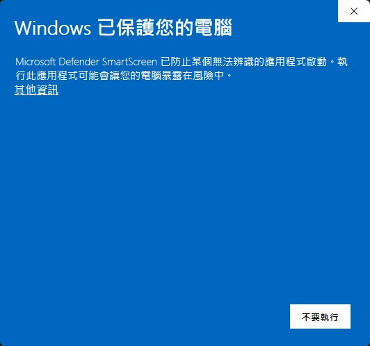
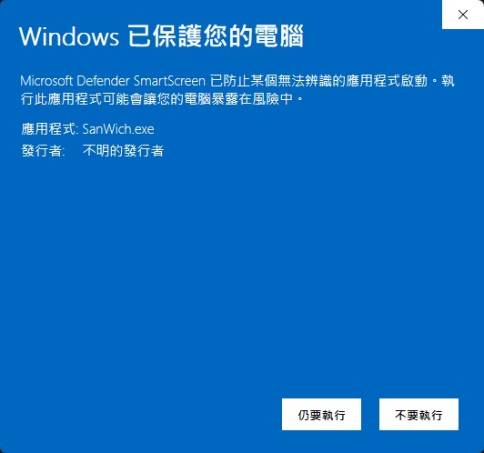
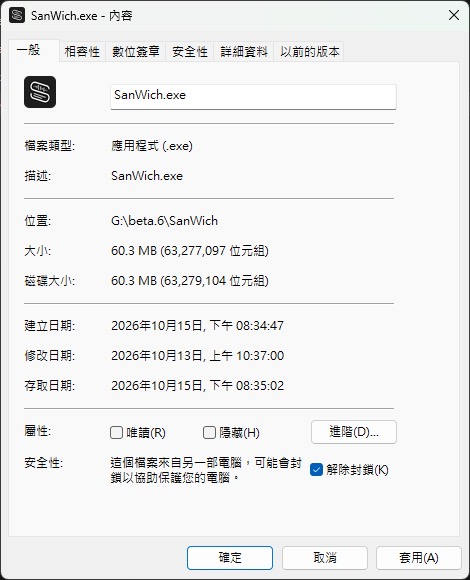

# SanWich V3 公測快速上手指南

適用版本：`3.0.0-beta.7`（公測候選）。實際下載檔名、開放功能與限制，請以該次發行說明及程式內顯示為準。

## 準備下載

| 檔案 | 用途 | 下載位置 |
|---|---|---|
| `SanWich_v3.0.0-beta.7_App_Lightweight.zip` | SanWich 主程式 | [WiKiVibe 官網](https://wikivibe.win/?app=sanwich) |
| `SanWich_AI_Engine_CUDA12_v3.zip` | AI 運算環境（可由程式下載，也可事先手動下載） | [Hugging Face：SanWich AI Engine](https://huggingface.co/WiKiVibe/SanWich-AI-Engine) |

檔名中的版本號會隨發行版本變動，請下載同一次發行說明所列的檔案。

## 開始使用

1. 將 `SanWich_v3.0.0-beta.7_App_Lightweight.zip` 解壓縮到可寫入的資料夾，例如使用者的「下載」或「文件」資料夾。
2. 開啟解壓後 `SanWich` 資料夾中的 `SanWich.exe`。程式檔案與同資料夾內的附屬檔案必須放在一起；之後移動程式時，請保留整個資料夾，不單獨搬移 EXE。
3. 首次開啟會顯示教學，並檢查 AI 運算環境與所選模型。可依畫面提示在教學期間下載所需檔案；模型下載到磁碟並通過檢查後才會顯示就緒。下載取消後，已下載的部分會保留，可再次重試。
4. 若已手動下載 `SanWich_AI_Engine_CUDA12_v3.zip`，可在準備畫面按「載入模型包」並選取該檔案。程式會先校驗檔案完整性再安裝，不符合時會停止。
5. 先用一小段熟悉的短片或音訊試做轉寫與 SRT 匯出，確認結果符合需求後，再處理完整工作素材。

### 第一次開啟時出現「Windows 已保護您的電腦」

SanWich 公測版還沒有購買 Windows 程式碼簽章憑證，所以第一次開啟 `SanWich.exe` 時，Windows 會顯示警告，發行者欄位會是「不明的發行者」。這是 Windows 對沒有簽章的新程式的一般提醒。請先確認檔案是從上述官方下載位置取得的，再用下面任一方式放行。

**方式一：看到警告時放行**

1. 在藍色的「Windows 已保護您的電腦」視窗，先點「**其他資訊**」。

   

2. 確認「應用程式」是 `SanWich.exe`，再按「**仍要執行**」。

   

**方式二：先解除封鎖再開啟**

1. 對 `SanWich.exe` 按右鍵，選「內容」。
2. 在「一般」分頁最下方「安全性」，勾選「**解除封鎖**」，按「確定」。

   

只需要做一次。如果你的防毒軟體攔截了 SanWich，請把整個 SanWich 資料夾加入信任清單，不要為了開啟 SanWich 而關閉防毒。仍然無法開啟時，請依下方「回報問題」寄信給我們。

## 登入與方案

- 純本機語音辨識：單一來源 5 分鐘內，不需登入。
- 使用 AI 校對：需在「版本與授權」以自己的電子郵件取得驗證碼並登入。Free 方案不需要 KEY。
- 取得 PLUS／PRO 或公測 KEY 後：在「版本與授權」登入，再輸入 KEY 並按「啟用」。方案與到期日以程式顯示為準。
- 各方案的功能、額度、時長限制與可用裝置數，請以 [WiKiVibe 官網](https://wikivibe.win/) 及程式內「版本與授權」為準。
- KEY、登入驗證碼與 API Key 請勿放在任何公開的問題回報中。

## 套用後續更新

從 beta.7 起，程式啟動後會自動檢查是否有新版；有新版時會提示，按下「立即更新」才會下載並更新，不會再問第二次，也可選「稍後」或「略過此版」。手動取得的更新檔仍可使用，步驟如下。

**從 beta.5 升級到 beta.7**：beta.5 沒有自動檢查更新，請依下方步驟手動套用 `SanWich_Update_v3.0.0-beta.7.zip`。這次升級仍用舊的更新方式，需要數分鐘，期間請不要重新開啟程式。AI 運算環境沿用 v3，不需要重新下載。

1. 從 WiKiVibe 官網下載適用目前版本的更新包，檔名形如 `SanWich_Update_v<版本>.zip`。更新包與首次安裝的主程式 ZIP 用途不同，請確認檔名。
2. 先儲存工作，並等待轉寫、下載或輸出工作結束。
3. 開啟「版本與授權」→「套用更新檔」，選擇下載的更新 ZIP。
4. 程式確認更新內容後會關閉並進行更新，完成後會自動重新開啟。從 beta.7 升級到之後的版本，一般約一分鐘，更新時會顯示「SanWich 正在更新」小視窗；從 beta.5 升級仍用舊的更新方式，需要數分鐘，畫面上不會有視窗。請耐心等待，**不要重新開啟程式**；重複開啟會被擋下並提示更新進行中。
5. 檔案、簽章或版本不符時，程式會拒絕更新。更新失敗時，請保留整個程式資料夾及其中的 `update_result.json`（若有），並回報問題。
6. 如果更新過程被中斷且主程式無法開啟，請先確認 SanWich 已關閉；若程式資料夾內附有 `RepairUpdate.bat`，可執行它嘗試復原。無法復原時，請保留原資料夾並回報，不要直接刪除備份。

一般更新不應清除個人設定、專案及已下載的模型。若某次發行需要重新下載完整主程式，請依該次發行說明，準備到新的資料夾並保留原有程式與資料。

## 回報問題

請寄信至 [service@wikivibe.win](mailto:service@wikivibe.win)，並盡量附上：

- SanWich 版本、Windows 版本與顯示卡型號。
- 使用的功能，以及發生問題前的操作步驟。
- 預期結果與實際結果（可附錯誤訊息或截圖）。

附上畫面或紀錄前，請先遮蔽授權碼、API Key、信箱及客戶資料；未公開的採訪素材請勿直接公開上傳。
